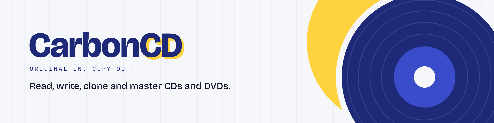

<p align="center">
  
</p>

# CarbonCD

CarbonCD is a Windows disc imaging tool from Rizonesoft. It reads a disc to an image file, writes an image to a disc, clones discs, masters data and audio discs, reads single tracks and analyses subcode.

## Where it stands

- **1.0.8** is the current release: 32-bit, CDs only. Its source is in `src/`.
- **2.0** is being built: 64-bit, Unicode, a new interface, and DVD support (read, write, clone, erase and data mastering). The plan is [todo/implementation-plan.md](todo/implementation-plan.md), the interface is [design/SPEC.md](design/SPEC.md) and the look is [design/DESIGN.md](design/DESIGN.md).

CarbonCD does not remove copy protection.

## Build

Open `CarbonCD.sln` in Visual Studio with the MFC component installed, or run:

```powershell
msbuild CarbonCD.sln -p:Configuration=Release -p:Platform=Win32
```

The executable is written to `Bin\Release`. The files it needs beside it (help and language files) are in `Distribution`.

## Layout

| Path | What it holds |
| ---- | ------------- |
| `src/` | Source, the project file and `res/` |
| `Bin/` | Build output |
| `Distribution/` | Help file and `.cml` language files shipped with the executable |
| `design/` | The design contract, interface spec, tokens, artwork and its build script |
| `todo/` | The plan for 2.0 |

## Licence

MIT. See [LICENSE](LICENSE). The bundled fonts are under the SIL Open Font License; their licences are in `design/fonts/`.
